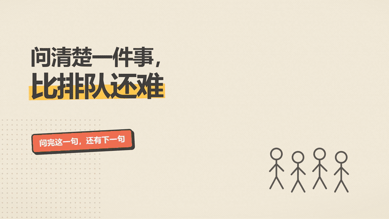
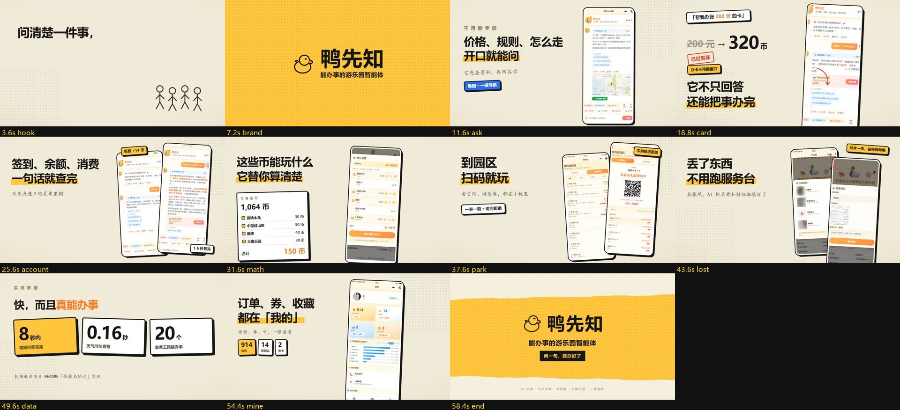
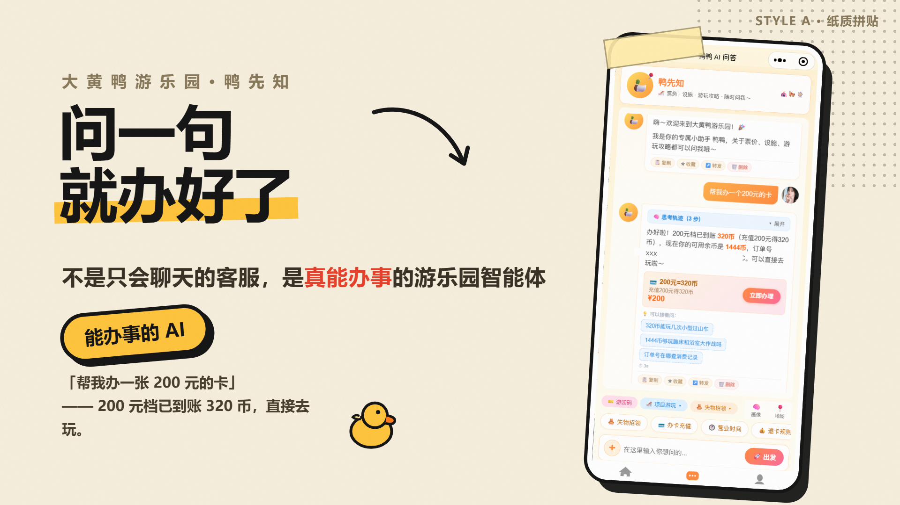

# 纸质拼贴宣传片生成器

把任意产品做成一支 **60 秒、纸质拼贴风**的宣传片：米白纸底、撕纸边、半调网点、
粗描边贴纸、真机截图装进手机贴纸里，全程卡在 120BPM 的拍点上。

不是一套滤镜，是一套**能直接渲染的工程**——克隆下来改文案、换截图、跑一条命令就能出片。



> **[▶ 看完整 60 秒成片](preview/demo-60s.mp4)** · 真实产品案例（大黄鸭游乐园 · 鸭先知）
> **[▶ 看模板自带 demo](preview/template-demo.mp4)** · 16 秒，纯代码绘制，无真实截图

---

## 这支片子长什么样



上排左起：痛点开场（实景 + 三张问题纸条）→ 品牌整屏黄（重拍进场）→ 问答推近 → 办卡高潮（数字滚动 + 印章）。

关键帧原图在 `preview/poster.jpg`，11 格分镜在 `preview/storyboard.jpg`。

## 三个关键决定

**1. 一切卡在拍点上。**
120 BPM 下一小节 2.0 秒，60 秒正好 30 小节。所有场景边界都是 2.0 的整数倍，
第 6 秒进鼓、品牌整屏揭开、第 56 秒片尾落定——不需要任何转场特效去遮剪辑点。

**2. 真有质感，不靠磨砂。**
纸张颗粒用 SVG turbulence 生成、半调网点用 radial-gradient 平铺、撕纸边用确定性伪随机
折线做 clip-path、所有阴影都是 `Npx Npx 0` 的硬阴影（不是模糊）。零位图素材。

**3. 真实截图是主角。**
每个功能段落至少一张真机截图，装进「手机贴纸」而不是裸贴。
代码只画包装（纸片、贴纸、印章、数字），不画产品本身。

## 风格样帧

接需求时会先出 4 个差异明显的方向给用户拍板，这是其中一次：

| A 纸质拼贴（本模板） | B 瑞士网格 |
|---|---|
|  |  |
| **C 复古霓虹** | **D 黑板手绘** |
|  |  |

## 快速开始

```bash
git clone <this-repo> paper-collage-promo
cd paper-collage-promo/template

npm i
python3 scripts/fonts.py      # Windows: python scripts/fonts.py
npx remotion studio           # 打开预览，改文案即时看到
```

渲染：

```bash
npx remotion render Promo out/demo.mp4
```

在 Node 18+ / macOS / Windows 上都能跑。需要 `ffmpeg`（混音、抽帧）和 Python 3.9+
（`numpy` `Pillow` `fonttools` `scipy` `brotli`，只在跑脚本时需要）。

## 换文案、换时间、换图

| 想改什么 | 改哪里 |
|---|---|
| 文案 | `template/src/scenes/Demo.tsx` 里的字面量 |
| 时长与剪辑点 | `template/src/timing.json`（**必须是 2.0s 的整数倍**） |
| 配色 | `template/src/lib/theme.ts` 的 `yellow / orange / red` |
| 截图 | 覆盖 `template/public/img/`，保持原比例 |
| 配乐 | 放 `template/audio-src/music.mp3`，跑 `python3 scripts/mix.py` |
| 镜头顺序 | `template/src/Promo.tsx` |

改完先抽静帧核对（几十秒），别直接渲全片：

```bash
node scripts/stills.mjs 3.2 9.5 18.8    # 指定秒数
node scripts/stills.mjs --scenes        # 每个场景取 35% 和 85%
```

## 目录

```
paper-collage-promo/
├── SKILL.md                  AI 用的入口：工作流、铁律、换皮清单
├── references/
│   ├── 01-style.md           配色/字号/纸张/贴纸/动效的全部参数
│   ├── 02-storyboard.md      60s = 30 小节的叙事结构模板
│   ├── 03-components.md      组件 API
│   ├── 04-shots.md           4K 截图、挑图、焦点裁切、音乐分析
│   └── 05-pitfalls.md        踩过的坑
├── preview/                  成片、动图、分镜图、风格样帧
└── template/                 可跑的 Remotion 工程
    ├── src/{timing.json, Promo.tsx, scenes, components, lib}
    ├── public/{img, audio, fonts}
    └── scripts/              fonts · music · mix · stills · check_video · shot · sheet
```

## 当作 AI Skill 用

仓库根目录的 `SKILL.md` 就是入口。把整个目录放到你的 agent skills 目录即可
（例如 `~/.workbuddy/skills/paper-collage-promo/`），之后说
「用纸质拼贴风给 XX 做一支 60 秒宣传片」就会按这套流程跑。

## 说明

- 参考成片里的产品截图来自真实项目，仅作风格示例；截图内容归原产品所有，请不要直接商用。
- 模板自带的 `public/audio/mix.wav` 是 16 秒静音占位，换成你自己的音乐后重跑 `scripts/mix.py`。
- 代码 MIT。

## License

MIT © 2026 Dayword
